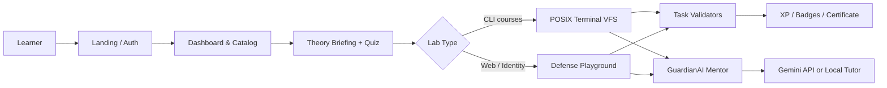
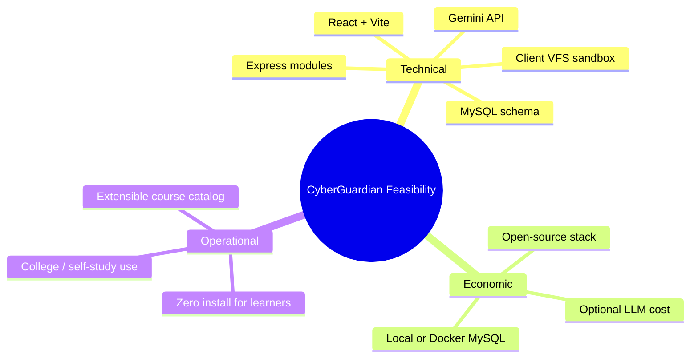

# 1. Introduction

## 1.1 Project Title
**CyberGuardian** — An AI-Assisted Cybersecurity Learning & Defense Platform

## 1.2 Document Purpose
This document introduces the CyberGuardian project: the educational problem it addresses, the project objectives, the functional and non-functional requirements, the scope of the delivered MVP, and the expected outcomes for learners and institutions.

---

## 1.3 Background
Cybersecurity threats grow more sophisticated every year, while many training programmes still rely on slides, definitions, and multiple-choice quizzes. Learners often know *what* SQL Injection or XSS is, but rarely get to:

1. Observe how an attack changes programme behaviour  
2. Apply a defensive fix  
3. Re-test and verify that the fix works  
4. Receive guided, ethical tutoring while they practice  

Real ranges (Kali, Metasploitable, full CTF networks) are powerful, but they are expensive to host, hard for beginners, and risky if misconfigured. CyberGuardian fills the gap with **zero-risk, in-browser laboratories**, structured theory, quizzes, badges, and a Socratic AI mentor (**GuardianAI / EOS**) that refuses help aimed at real systems.

---

## 1.4 Problem Statement
Existing cybersecurity learning often separates theory from practice. Students struggle to connect vulnerability definitions with real attack behaviour and remediation. Live experimentation on production or poorly isolated systems also creates security and ethical risk.

**Need:** A secure, interactive platform where users can study attacks, observe them in controlled sandboxes, practise mitigation, and receive personalised AI guidance — without ever touching real-world targets.

---

## 1.5 Project Objectives

| # | Objective |
|---|-----------|
| 1 | Provide structured learning modules for fundamental cybersecurity concepts |
| 2 | Demonstrate common attack techniques through isolated simulations |
| 3 | Teach defensive mechanisms and secure coding practices |
| 4 | Provide an AI tutor that explains concepts in accessible language |
| 5 | Offer hands-on labs in a secure sandbox (no real-system impact) |
| 6 | Evaluate understanding through quizzes and practical task completion |
| 7 | Track progress, XP, badges, and course certificates |
| 8 | Enforce ethical learning boundaries (refuse real-world attack assistance) |

---

## 1.6 Solution Overview
CyberGuardian is a full-stack web application:

- **Frontend:** React + Vite SPA with a dark cyber-defence UI, xterm.js terminal, theory briefings, and Exploit/Defense playgrounds  
- **Backend:** Node.js + Express hybrid monolith (auth, courses, progress, badges, lab logs, mentor gateway)  
- **Database:** MySQL 8 for users, courses, modules, progress, quizzes, badges, and command audit logs  
- **AI:** Google Gemini (with local Socratic fallback) behind ethical guardrails  
- **Sandbox model:** Client-side virtual filesystem + mock vulnerable apps — **no remote shell execution on the server**

---

## 1.7 Functional Requirements (Summary)

### Authentication
- Register and log in with email/password  
- Passwords stored with bcrypt  
- Signed session tokens issued after successful login  

### Learning & Dashboard
- Courses: Linux Fundamentals, Web/OWASP, Network Forensics, SOC Triage, Phishing & Password Defense  
- Dashboard shows XP, module completion, and resume points  

### Attack Simulation & Defense
- Terminal labs for Linux, network, and SOC modules  
- Interactive playgrounds for SQLi, XSS, JWT, path traversal, headers, phishing, and password hashing  
- Exploit view shows the failure; Defense view proves the fix  

### AI Tutor
- Context-aware hints for the active module/task  
- Refuses malware, real-domain attacks, and weaponization requests  

### Assessment & Progress
- Pre-flight knowledge checks  
- Task completion XP, module bonuses, quiz XP  
- Badges and course completion certificates  

---

## 1.8 Non-Functional Requirements

| Area | Requirement |
|------|-------------|
| Security & Ethics | Isolated labs only; hashed passwords; tutor guardrails |
| Performance | Instant lab load (client-side sandbox); AI replies within a few seconds |
| Usability | Browser-only; beginner-friendly mission directives |
| Reliability | Progress persisted in MySQL when API is online |
| Maintainability | Modular Express domains + data-driven course definitions |

---

## 1.9 Feasibility

---

## 1.10 Scope of the Delivered System

### In scope (delivered)
- Auth, dashboard, catalog, profile  
- Five course tracks with interactive labs  
- Theory briefings + quizzes  
- GuardianAI mentor (Gemini + local fallback)  
- Progress, XP, badges, certificates  
- Smoke tests for terminal/playground tasks  

### Out of scope (intentionally deferred)
- Real Docker attack ranges / Kali GUI sessions  
- Multiplayer CTF / live MITM arenas  
- Custom LLM training  
- Instructor LMS / gradebook  
- Covering the entire OWASP/CWE catalogue  

---

## 1.11 Expected Outcome
A functional web-based cybersecurity education platform that helps learners:

1. Understand *why* vulnerabilities exist  
2. Safely observe attack behaviour in a sandbox  
3. Practise and verify defensive controls  
4. Build progressive mastery through XP, badges, and certificates  
5. Receive ethical, Socratic AI guidance  

---

## 1.12 Document Map
| File | Contents |
|------|----------|
| [01_Introduction.md](./01_Introduction.md) | This document |
| [02_System_Architecture_and_HLD.md](./02_System_Architecture_and_HLD.md) | Architecture, stack, data model, diagrams |
| [03_Implementation_Details_and_Core_Code_Logic.md](./03_Implementation_Details_and_Core_Code_Logic.md) | Modules, labs, mentor, key algorithms |
| [04_Result_Analysis_and_Testing.md](./04_Result_Analysis_and_Testing.md) | Tests, results, evaluation |
| [05_Conclusion_and_Future_Scope.md](./05_Conclusion_and_Future_Scope.md) | Conclusions and roadmap |
