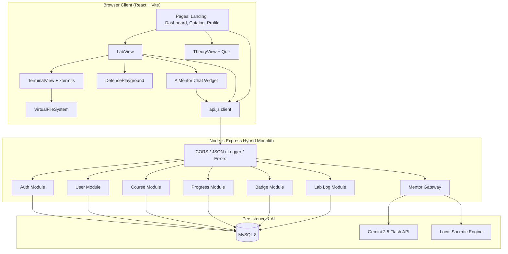
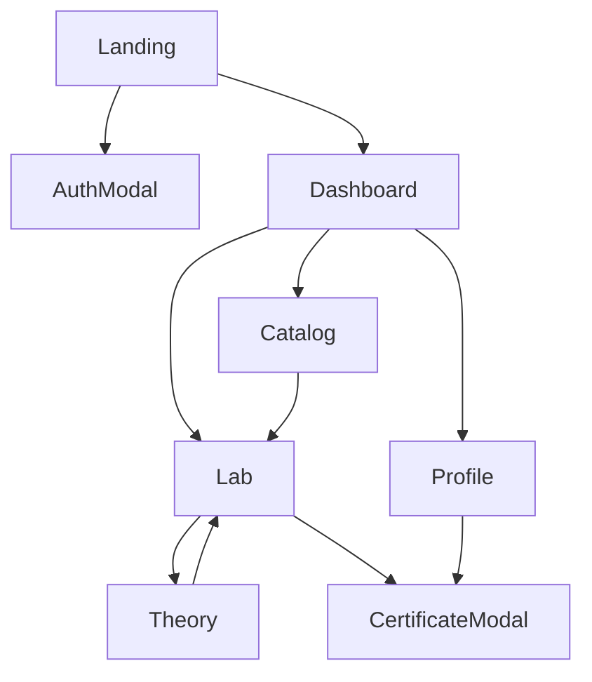
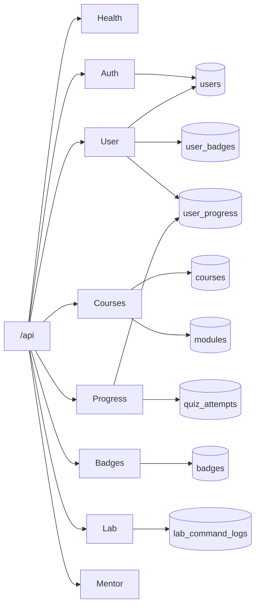
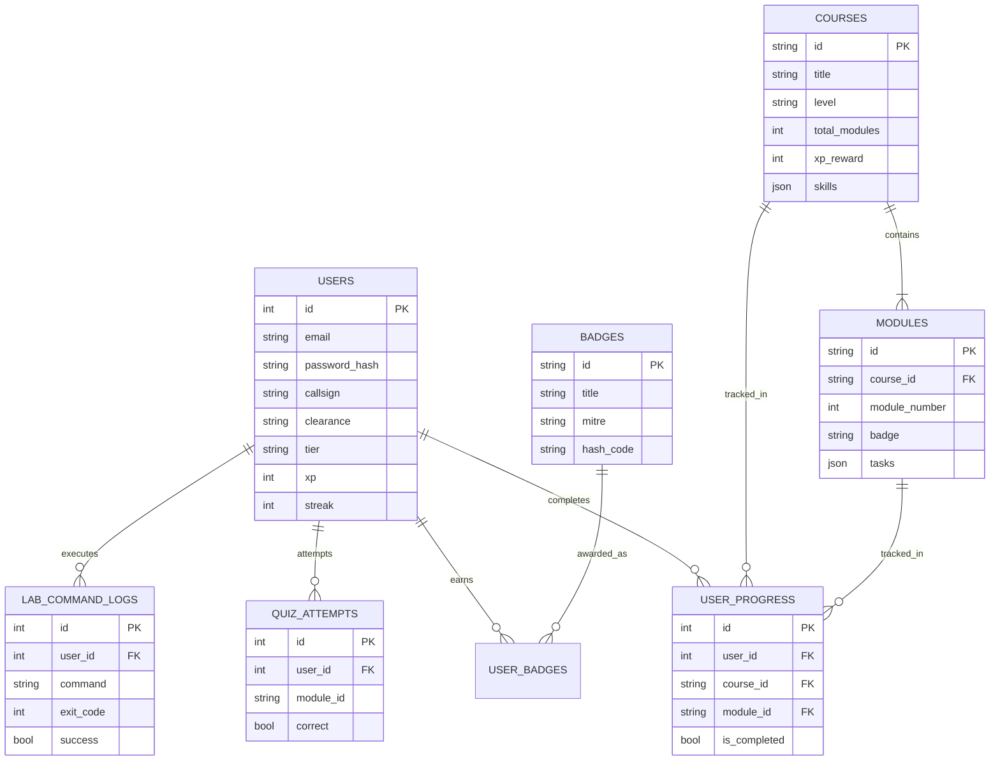
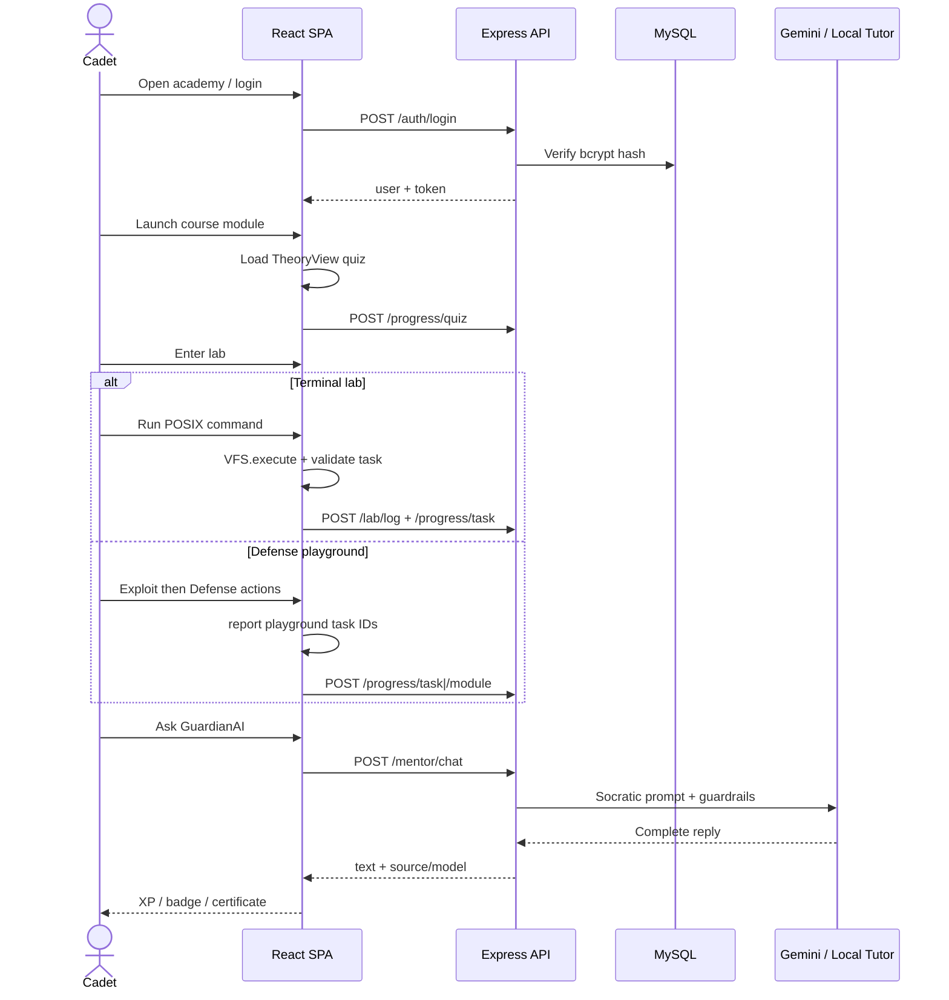
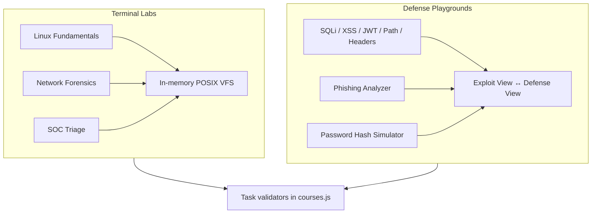
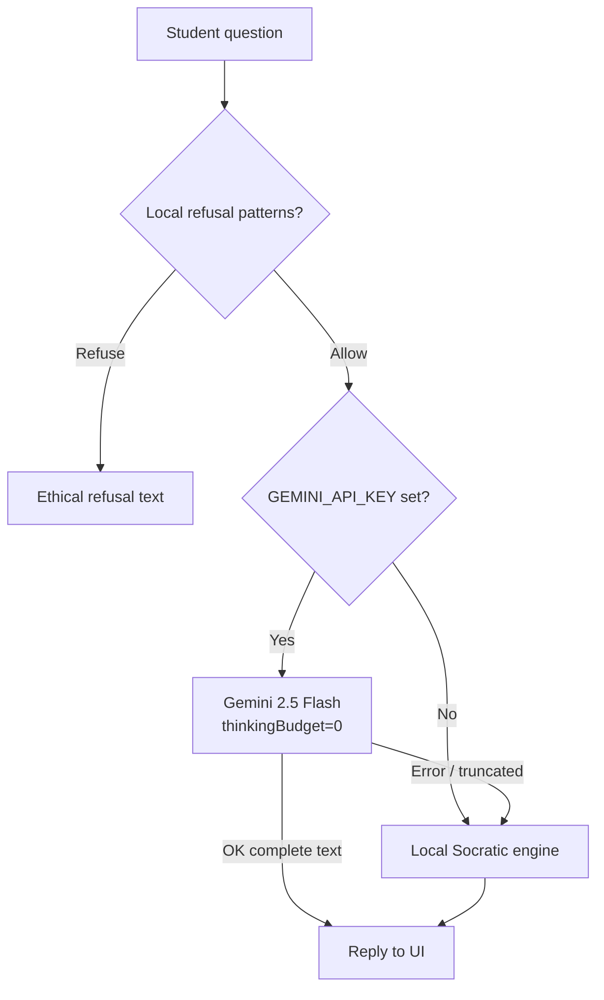
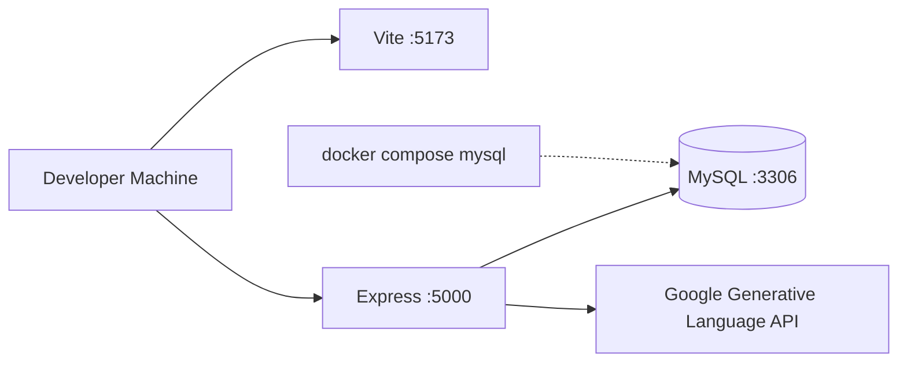
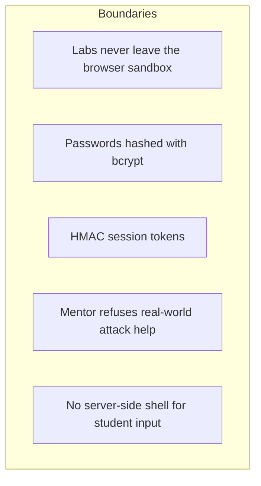

# 2. System Architecture & High-Level Design

## 2.1 Architectural Style
CyberGuardian uses a **hybrid monolith** backend and a **single-page application (SPA)** frontend.

- The Express server is organised by domain modules (auth, user, course, progress, badge, lab, mentor, health).  
- The React SPA owns all interactive labs. Attack simulations never execute shell code on the server.  
- MySQL stores durable learning state. Gemini (optional) powers the mentor through a backend gateway.

This matches MVP Concept A from the project roadmap: **Interactive In-Browser Cyber Lab** — ultra-low infrastructure cost and 100% sandbox isolation by design.

---

## 2.2 High-Level Component Diagram

---

## 2.3 Technology Stack

| Layer | Choice | Role |
|-------|--------|------|
| UI Framework | React 18 | Component-driven learning UX |
| Build Tool | Vite 6 | Fast SPA builds and HMR |
| Styling | Tailwind CSS 3 | Utility-first cyber UI |
| Terminal | `@xterm/xterm` + FitAddon | In-browser POSIX feel |
| Backend | Express 5 | REST API hybrid monolith |
| Auth crypto | bcryptjs + HMAC tokens | Password hashing + sessions |
| Database | MySQL 8.4 (`mysql2`) | Relational progress model |
| AI | Gemini API (`GEMINI_API_KEY`) | Socratic tutoring |
| AI fallback | `shared/guardian-engine.js` | Works offline / on refusal |
| Optional infra | Docker Compose MySQL | Portable DB when needed |
| Dev orchestration | concurrently | `npm run dev:all` |

---

## 2.4 Frontend Information Architecture

### Major UI surfaces
| Page / Component | Responsibility |
|------------------|----------------|
| `LandingPage` | Marketing + CTA into academy |
| `AuthModal` | Login / register / demo clearance |
| `Dashboard` | Resume lab, track switcher, XP |
| `CourseCatalog` | Five pathways → launch correct course |
| `CadetProfile` | Badges, skill radar, certificates |
| `TheoryView` | Threat scenario, concepts, quiz |
| `LabView` | Split: directives/AI + terminal/playground |
| `DefensePlayground` | Exploit vs Defense interactive labs |
| `TerminalView` | xterm bound to VFS |
| `AiMentor` | Chat UI for GuardianAI |
| `CertificateModal` | Course completion artefact |

---

## 2.5 Backend Module Map

### Representative endpoints
| Method | Path | Purpose |
|--------|------|---------|
| GET | `/api/health` | DB connectivity & service status |
| POST | `/api/auth/login` | Authenticate / auto-provision demo |
| POST | `/api/auth/register` | Enrol cadet |
| GET | `/api/auth/session` | Validate bearer token |
| GET | `/api/user/profile/:id` | Profile, badges, completed modules |
| GET | `/api/courses` | Course catalogue from DB |
| POST | `/api/progress/task` | Credit task XP |
| POST | `/api/progress/module` | Mark module complete + bonus XP |
| POST | `/api/progress/quiz` | Persist quiz attempt |
| POST | `/api/lab/log` | Audit sandbox commands |
| POST | `/api/mentor/chat` | GuardianAI reply |

---

## 2.6 Logical Data Model

---

## 2.7 Learning Experience Flow (End-to-End)

---

## 2.8 Lab Subsystem Design

### Two sandbox strategies

### Why client-side sandboxes?
1. **Safety:** no server RCE surface from student commands  
2. **Speed:** labs start instantly  
3. **Cost:** no per-user container fleet for MVP  
4. **Pedagogy:** still supports observe → fix → verify loops  

---

## 2.9 GuardianAI Design

Design principles:
- Socratic hints over ready-made exploit dumps  
- Module/task context injected into prompts  
- Thinking disabled so replies do not truncate mid-sentence  
- Hard refusals for real domains, malware, and weaponization  

---

## 2.10 Deployment View

### Runtime commands
| Command | Effect |
|---------|--------|
| `npm run db:setup` | Migrate schema + seed |
| `npm run db:up` | Start MySQL via Docker Compose |
| `npm run dev:all` | Vite + API together |
| `npm run smoke:labs` | Validate all lab tasks |
| `npm run build` | Production frontend bundle |

### Environment (high level)
- `PORT`, `VITE_API_URL`  
- `DB_HOST`, `DB_PORT`, `DB_USER`, `DB_PASSWORD`, `DB_NAME`  
- `JWT_SECRET`  
- `AI_PROVIDER`, `AI_MODEL`, `GEMINI_API_KEY`  

---

## 2.11 Security Architecture (MVP)

Threats explicitly *not* introduced by the MVP design:
- Arbitrary remote code execution from lab commands  
- Live phishing campaigns against real people  
- Password cracking against real hashes outside the printed practice list  

---

## 2.12 Design Decisions Summary

| Decision | Rationale |
|----------|-----------|
| SPA + hybrid monolith | Fast academic delivery; clear module boundaries |
| MySQL relational model | Natural fit for users ↔ courses ↔ progress |
| Client VFS / playgrounds | Safety + cost for beginner labs |
| Gemini behind Express | Keep API key off the browser; centralise guardrails |
| Data-driven `courses.js` | Add modules without rewriting UI shells |
| Exploit/Defense toggle | Enforces observe → remediate → verify pedagogy |
