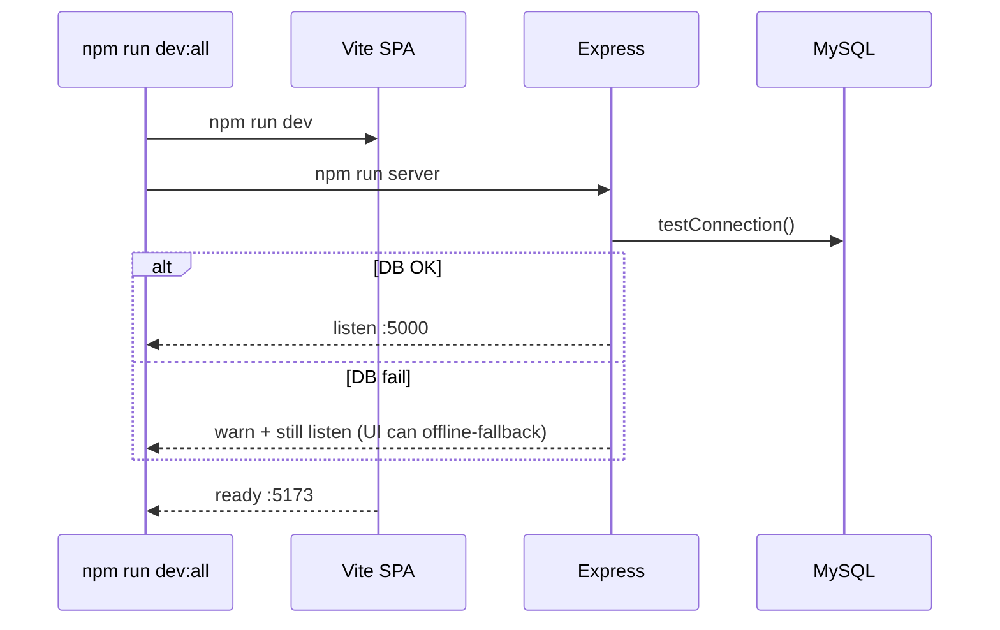
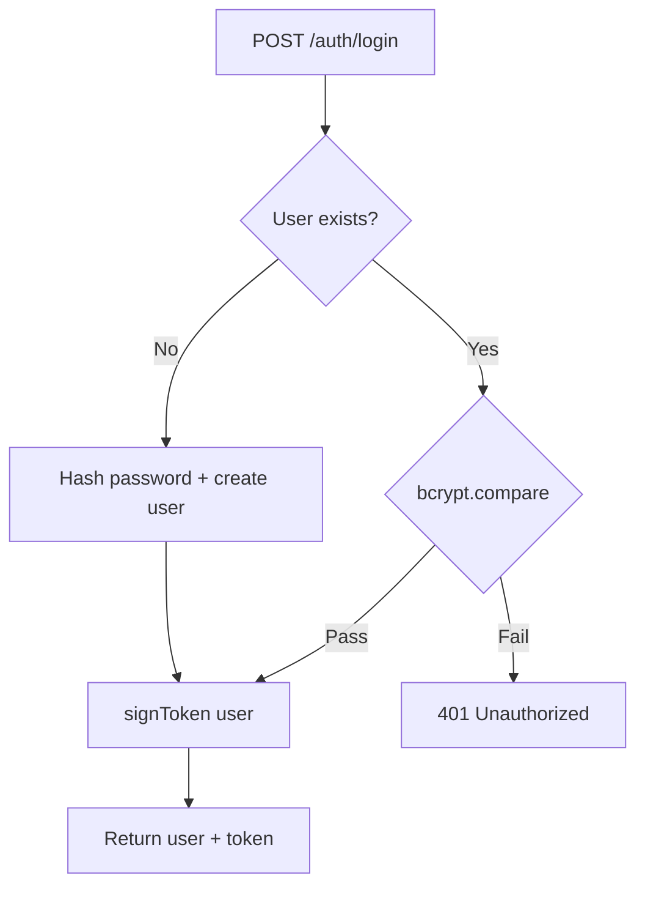
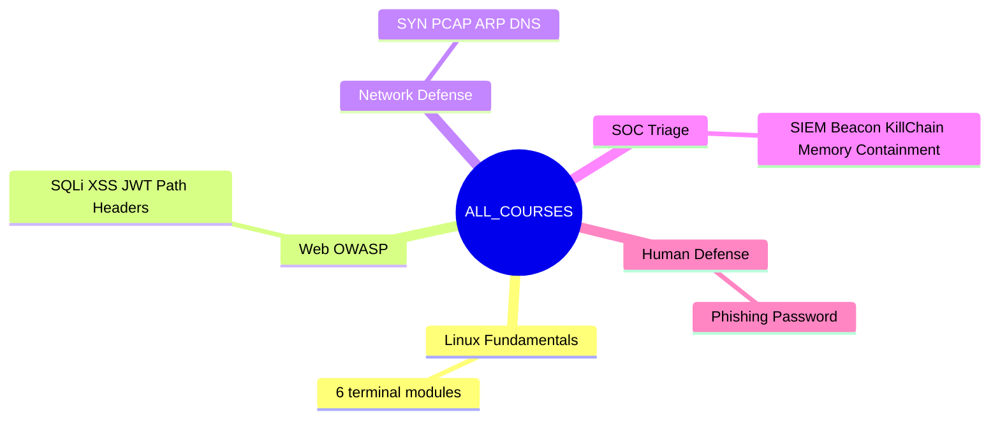
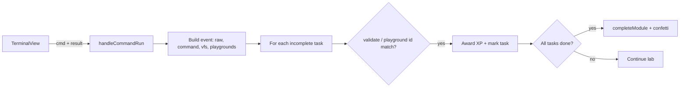
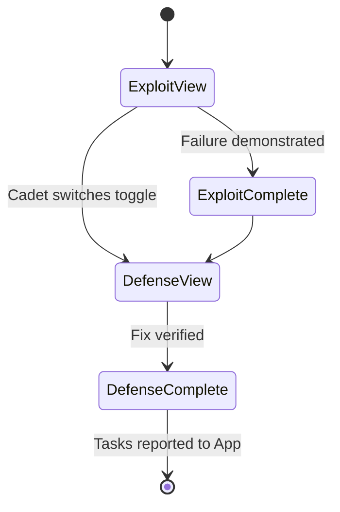
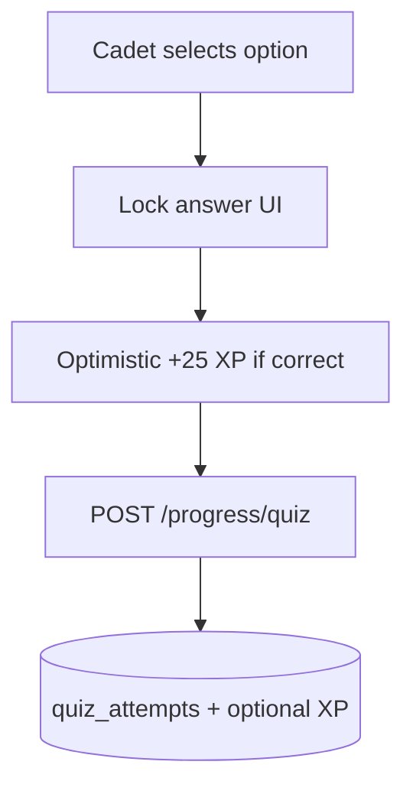
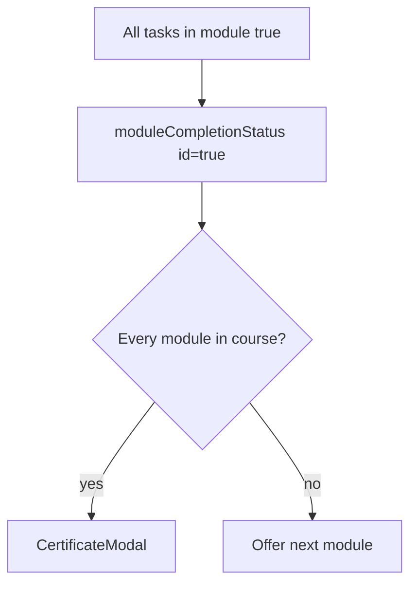
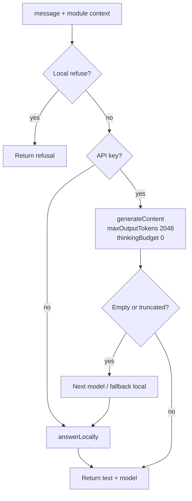
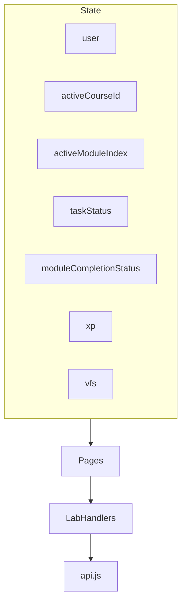
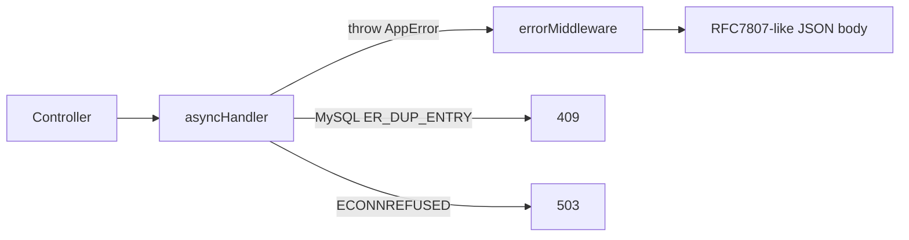

# 3. Implementation Details & Core Code Logic

## 3.1 Repository Layout

```text
CyberGuardian/
├── src/                      # React SPA
│   ├── App.jsx               # Page router, XP, lab orchestration
│   ├── components/           # UI surfaces (Lab, Theory, Mentor, ...)
│   ├── data/courses.js       # Course/module/task definitions + validators
│   └── services/
│       ├── api.js            # Backend HTTP client
│       └── vfs.js            # In-memory POSIX interpreter
├── server/                   # Express hybrid monolith
│   ├── app.js                # Middleware + route mounting
│   ├── index.js              # Boot + MySQL health check
│   ├── config/env.config.js  # Typed environment singleton
│   ├── database/             # Migrator, seeder, connection pool
│   └── modules/              # auth, user, course, progress, badge, lab, mentor, health
├── shared/
│   └── guardian-engine.js    # Shared local tutor + system prompt
├── scripts/                  # Smoke / probe utilities
├── docker-compose.yml        # Optional MySQL
└── docs/Final docs/          # Project documentation (this set)
```

---

## 3.2 Application Boot Sequence



Key boot files:
- `server/index.js` — prints enclave banner, tests DB, listens on `config.port`
- `server/app.js` — mounts domain routers under `/api`
- `src/main.jsx` — mounts React root

---

## 3.3 Authentication Logic

### Flow



### Implementation notes
- Passwords hashed with `bcryptjs` (`Hasher` utility, configurable salt rounds).  
- Session tokens are HMAC-SHA256 over a base64url payload (`sub`, `email`, `exp`) using `JWT_SECRET`.  
- Frontend stores token in `localStorage` (`cg_token`) and sends `Authorization: Bearer …` when present.  
- Demo credentials (seeded): `neo@cyberguard.academy` / `cybercadet2026`.

Relevant files:
- `server/modules/auth/auth.service.js`
- `server/shared/utils/token.util.js`
- `server/shared/utils/hasher.util.js`
- `src/components/AuthModal.jsx`

---

## 3.4 Course Data Model (Frontend Source of Truth for Labs)

Courses live in `src/data/courses.js` as `ALL_COURSES`. Each module contains:

| Field | Meaning |
|-------|---------|
| `id`, `number`, `title`, `badge` | Identity & reward label |
| `briefing`, `description` | Pedagogy copy |
| `playground` *(optional)* | Opens DefensePlayground kind |
| `tasks[]` | Mission directives |
| `tasks[].validate(event, vfs)` | Completion predicate |
| `tasks[].commandHint` / `hint` | Guidance for cadets & AI |

### Course catalogue (implemented)



A mirrored seed exists in `server/database/seed-data/courses.seed.js` for DB catalogue APIs.

---

## 3.5 Terminal Lab Engine (`VirtualFileSystem`)

### Purpose
Provide a **safe POSIX-like shell** entirely in memory: files, permissions, processes, pipes, and redirects — with no host filesystem access.

### Command pipeline

```mermaid
flowchart TD
  Raw[Raw command string] --> Hist[Push history]
  Hist --> Redir{> or >> ?}
  Redir --> PipeSplit[Split on |]
  PipeSplit --> Loop[For each stage]
  Loop --> Run[runSingleCommand]
  Run --> Stdin[Feed stdout to next stage]
  Stdin --> Loop
  Loop --> Write{Redirect target?}
  Write -->|yes| FileWrite[Write/append virtual file]
  Write -->|no| Out[Return output + exit code]
  FileWrite --> Out
  Out --> Notify[notify listeners / App validators]
```

### Supported commands (core)
`pwd`, `cd`, `ls`, `mkdir`, `touch`, `cat`, `head`, `tail`, `cp`, `mv`, `rm`, `grep`, `find`, `wc`, `chmod`, `chown`, `ps`, `kill`, `echo`, `ping`, `curl`, `ifconfig`/`ip`, `uname`, `whoami`, `help`, …

### Example: Linux Module 1 validation logic
- `pwd` succeeds when command is `pwd`  
- `ls -la` succeeds when flags include all-files listing  
- `mkdir -p ~/defense/audit` succeeds when the directory node exists  
- `cd ~/defense/audit` succeeds when `vfs.cwd` matches  

Binding happens in `App.jsx` → `handleCommandRun`:



---

## 3.6 Defense Playground Logic

File: `src/components/DefensePlayground.jsx`

### Shared pattern



### Lab-specific algorithms

#### SQL Injection
1. **Exploit:** concatenate username/password into a mock SQL string; tautologies return all practice rows.  
2. **Defense:** keep SQL fixed with `?` placeholders; compare bound values literally so injection text never becomes syntax.  
3. Reports `t_sqli_inspect`, `t_sqli_grep`, then `t_sqli_patch`.

#### XSS
1. **Exploit:** detect markup (`<script`, `onerror=`, …) and show simulated impact **without executing it**.  
2. **Defense:** HTML-escape the same input; tags become inert text.

#### JWT
1. **Exploit:** accept `alg: none` unsigned tokens and honour forged `role` claims.  
2. **Defense:** require HS256 + signature marker; reject unsigned tokens.

#### Path Traversal
1. **Exploit:** naive join of user path allows `../../etc/passwd` style reads on a fake FS map.  
2. **Defense:** `basename` isolation into `/var/www/uploads`.

#### Headers
1. **Exploit:** audit soft/missing CSP, HSTS, X-Frame-Options.  
2. **Defense:** enable all three and verify.

#### Phishing
1. **Exploit:** mark ≥4 red flags on a fabricated sample message.  
2. **Defense:** enable lookalike, link-mismatch, and macro filters; quarantine sample.

#### Password
1. **Exploit:** walk a **six-word printed list** with a fast comparison (educational only).  
2. **Defense:** slow hash timing + 3-attempt rate limit stops the run.

---

## 3.7 Theory & Quiz Logic

`TheoryView.jsx` presents:
1. Threat scenario + MITRE/NIST framing  
2. Core concepts  
3. Command/syntax cards  
4. Pre-flight knowledge check  

On first answer selection:



Fallback theory content is generated for modules without a handcrafted briefing entry.

---

## 3.8 Progress, Badges & Certificates

### XP sources
| Event | Typical XP |
|-------|------------|
| Task completion | +100 per newly completed task |
| Module completion | +250 bonus |
| Correct quiz | +25 |

### Persistence
- `POST /progress/task` → `users.xp += n`  
- `POST /progress/module` → upsert `user_progress` + bonus XP  
- Profile reload maps completed module IDs into UI state  

### Certificates
When every module in the active course is complete, `CertificateModal` opens and can download a plain-text certificate artefact.



---

## 3.9 GuardianAI Implementation

### Shared engine (`shared/guardian-engine.js`)
- Local topic replies (permissions, SQLi, XSS, phishing, passwords, JWT, network, SOC)  
- Hard refusal patterns (jailbreaks, malware asks, real-domain attack requests)  
- System prompt: Socratic, defensive, complete sentences only  

### Gateway (`server/modules/mentor/mentor.service.js`)



### UI (`AiMentor.jsx`)
- Calls `api.askMentor`  
- Falls back to local engine if API offline  
- Uses knowledge-base shortcuts for common CLI questions when needed  
- Avoids duplicate “Switched context” spam via a module ref  

---

## 3.10 Frontend Orchestration (`App.jsx`)

Central responsibilities:
1. Page routing (`landing | dashboard | catalog | profile | lab | theory`)  
2. Active course/module indices  
3. Task status map + ref (avoids stale closures during rapid playground reports)  
4. XP and module completion maps  
5. Launch lab → reset VFS + task status for a clean sandbox  
6. Wire Theory quiz + Certificate modal  



---

## 3.11 Database Migration & Seeding

`DatabaseMigrator` creates tables if missing:  
`users`, `courses`, `modules`, `badges`, `user_progress`, `user_badges`, `lab_command_logs`, `quiz_attempts`.

`DatabaseSeeder` loads:
- Demo users  
- Course/module metadata  
- Badge catalogue  
- Baseline progress for Agent Neo  

Command: `npm run db:setup`

---

## 3.12 API Client Contract (`src/services/api.js`)

Key methods:
- `checkHealth`, `login`, `register`  
- `getUserProfile`, `getCourses`  
- `recordTaskXP`, `completeModule`, `recordQuiz`  
- `askMentor`, `logLabCommand`  

Offline behaviour: most methods return `null` / soft-fail so the SPA remains usable for local lab practice.

---

## 3.13 Error Handling Strategy



Domain errors: `ValidationError`, `UnauthorizedError`, `NotFoundError`, `ConflictError`.

---

## 3.14 Extending the Platform (Developer Guide)

### Add a terminal module
1. Append a module object to the right course in `src/data/courses.js`  
2. Ensure referenced files exist in `vfs.js`  
3. Write `validate` functions against command events / VFS state  
4. Mirror metadata in `courses.seed.js` and re-run `db:setup`  
5. Run `npm run smoke:labs`

### Add a playground lab
1. Add a `playground: 'kind'` field on the module  
2. Implement UI + `report([...taskIds])` in `DefensePlayground.jsx`  
3. Accept `event.playground === taskId` in validators  

### Add a mentor topic
1. Extend `topicReply` / refusal patterns in `guardian-engine.js`  
2. Keep answers defensive and complete  

---

## 3.15 Core Algorithms Summary

| Concern | Algorithm / Pattern |
|---------|---------------------|
| Lab isolation | Client-side simulation only |
| Task completion | Predicate over command events or playground IDs |
| Password storage | bcrypt hash + compare |
| Sessions | HMAC token with expiry |
| Mentor safety | Local refuse → optional LLM → truncation check → local fallback |
| Progress | Optimistic UI + durable MySQL writes |
| Pedagogy | Theory → Quiz → Exploit → Defense → Verify |
