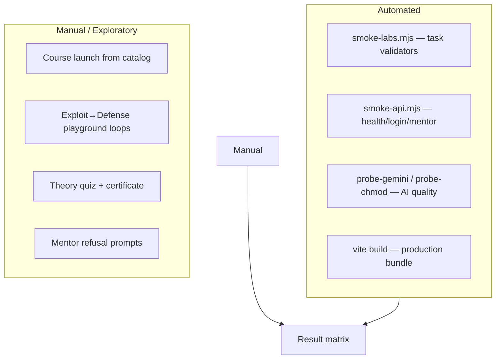
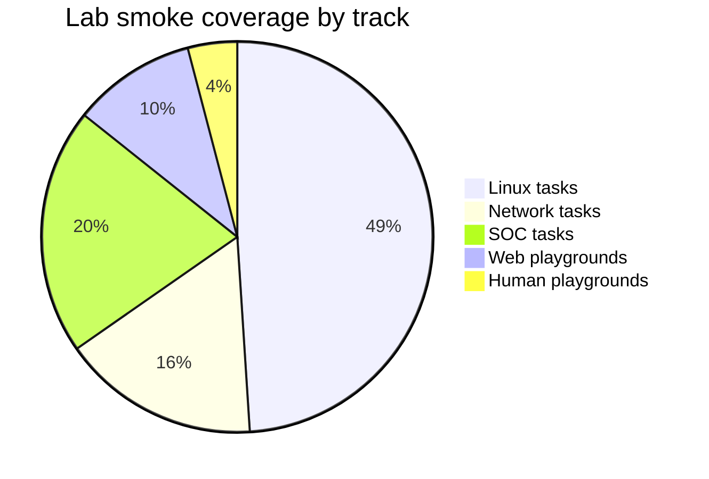
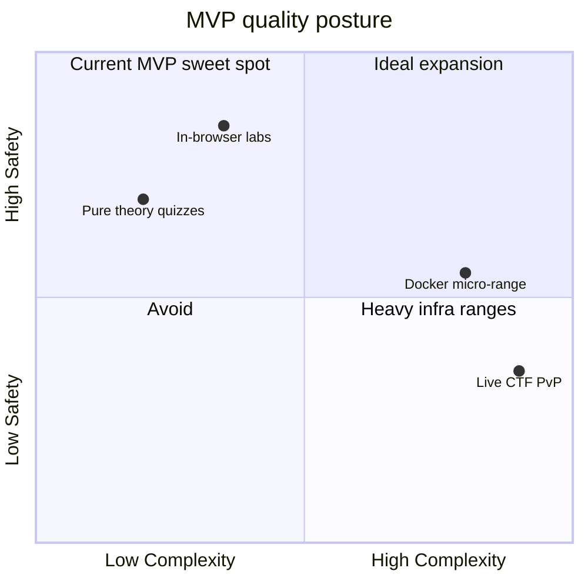
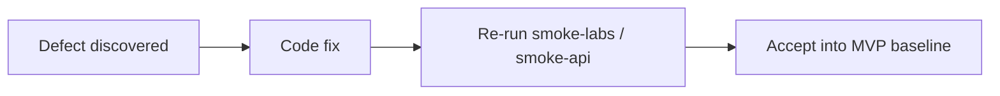
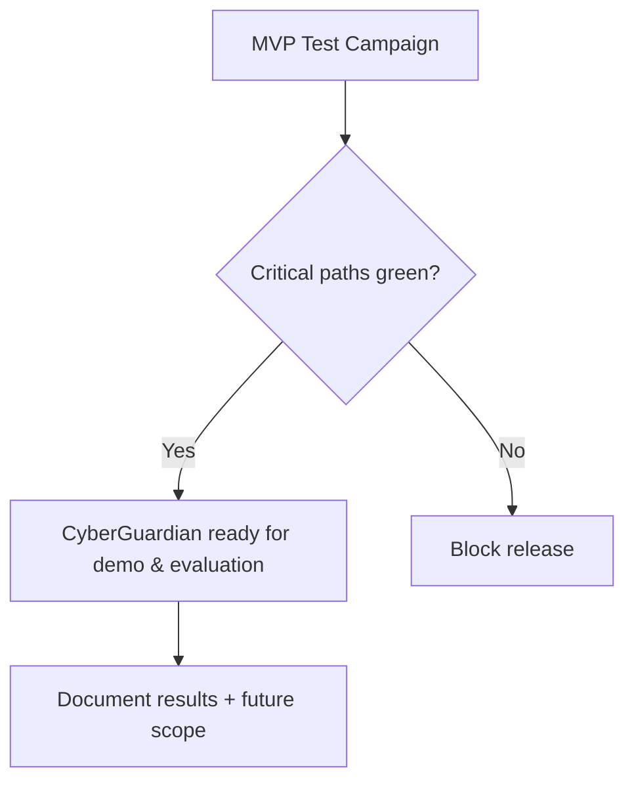

# 4. Result Analysis & Testing

## 4.1 Testing Objectives
The testing effort for CyberGuardian validates that:

1. Every lab task can be completed as designed  
2. Authentication and progress persistence work against MySQL  
3. GuardianAI returns **complete**, ethical replies via Gemini  
4. The SPA builds and serves without runtime bundling failures  
5. Sandboxes remain isolated from real systems  

---

## 4.2 Test Strategy Overview



---

## 4.3 Environment Under Test

| Component | Configuration |
|-----------|---------------|
| OS | Windows 10/11 development host |
| Frontend | Vite 6 + React 18 @ `http://localhost:5173` |
| Backend | Express @ `http://localhost:5000` |
| Database | MySQL 8.4.8 database `cyberguardian` |
| AI | Gemini `gemini-2.5-flash` via `GEMINI_API_KEY` |
| Demo user | `neo@cyberguard.academy` / `cybercadet2026` |

Commands used during verification:
```bash
npm run db:setup
npm run smoke:labs
npm run dev:all
node scripts/smoke-api.mjs
node scripts/probe-chmod.mjs
npm run build
```

---

## 4.4 Automated Lab Smoke Results

`scripts/smoke-labs.mjs` instantiates `VirtualFileSystem`, executes each terminal task’s `commandHint`, and asserts `task.validate(...)`. Playground modules are asserted present by `playground` kind.

### Aggregate outcome

| Track | Modules | Lab mode | Smoke result |
|-------|---------|----------|--------------|
| Linux Fundamentals | 6 | Terminal VFS | **PASS** (all tasks) |
| Web Application Security | 5 | Playgrounds | **PASS** (kinds present) |
| Network Forensics | 4 | Terminal VFS | **PASS** |
| SOC Triage | 5 | Terminal VFS | **PASS** |
| Phishing & Password Defense | 2 | Playgrounds | **PASS** |

Representative terminal successes include: `pwd`, `ls -la`, `chmod`, `grep` pipelines, `ps`/`kill`, `curl -I`, SYN/DNS/SIEM log inspections, and containment policy verification.



> Exact task counts may vary slightly as modules evolve; the smoke script is the authoritative gate.

---

## 4.5 API Integration Results

`scripts/smoke-api.mjs` checks the live stack:

| Check | Expected | Observed |
|-------|----------|----------|
| `GET /api/health` | `database.success = true` | **PASS** |
| `POST /auth/login` | token + user payload | **PASS** (`Agent Neo`) |
| `POST /mentor/chat` | non-empty Gemini reply | **PASS** (`source=gemini`, model=`gemini-2.5-flash`) |

### Truncation regression (chmod prompt)
Earlier Gemini replies stopped mid-sentence because thinking tokens consumed `maxOutputTokens`.

| Before fix | After fix |
|------------|-----------|
| `"When you use \`chmod 777"` (cut off) | Full multi-sentence Socratic answer |
| Finish reason effectively token-starved | `thinkingBudget: 0`, 2048 output tokens, truncation detector |

`probe-chmod.mjs` confirms replies end with a complete sentence terminator.

---

## 4.6 Functional Test Matrix (Manual)

| ID | Scenario | Steps | Expected | Result |
|----|----------|-------|----------|--------|
| F-01 | Register / Login | Open AuthModal, sign in | Dashboard loads, DB badge may show connected | PASS |
| F-02 | Launch Linux lab | Catalog → Linux → Enter Sandbox | Terminal + directives for Mod 01 | PASS |
| F-03 | Complete a terminal task | Run hinted command | Task ticks; XP increases | PASS |
| F-04 | SQLi playground | Exploit tautology → Defense bindings | Both task groups complete | PASS |
| F-05 | XSS playground | Publish markup → escape in Defense | Tasks complete; no script execution | PASS |
| F-06 | Phishing playground | Mark ≥4 flags → enable filters | Quarantine + tasks complete | PASS |
| F-07 | Password playground | Fast list → slow+rate-limit | Tasks complete | PASS |
| F-08 | Theory quiz | Answer knowledge check | Feedback + quiz API write | PASS |
| F-09 | Course certificate | Finish all modules in a course | Certificate modal appears | PASS |
| F-10 | Mentor ethics | Ask to hack a real domain | Refusal message | PASS |
| F-11 | Catalog course wiring | Launch Web / Network / SOC / Human tracks | Correct `courseId` opens | PASS |
| F-12 | Lab reset | Reset / relaunch lab | Fresh VFS + cleared task map | PASS |

---

## 4.7 Non-Functional Evaluation



| Attribute | Observation |
|-----------|-------------|
| Performance | Labs start instantly (no container spin-up) |
| Safety | No student shell reaches the server host |
| AI latency | Typically a few seconds with Gemini Flash |
| Reliability | MySQL persistence when API online; offline soft-fallback for practice |
| Usability | Mission directives + hints keep beginners oriented |
| Maintainability | Data-driven courses; modular Express domains |

---

## 4.8 Build & Packaging Results

| Artefact | Command | Result |
|----------|---------|--------|
| Production SPA | `npm run build` | Success (Vite bundle in `dist/`) |
| DB schema | `npm run db:setup` | Migrations + seeds applied |
| Optional MySQL container | `docker compose up -d mysql` | Available via `npm run db:up` |

Note: production JS chunk size is large (~1 MB) due to xterm and UI assets. Acceptable for MVP; code-splitting is listed under future work.

---

## 4.9 Defects Found & Resolutions

| Defect | Impact | Resolution |
|--------|--------|------------|
| Catalog always opened Linux course | Wrong labs | Pass `courseId` into `handleLaunchLab` |
| Theory button unbound | Dead UI | Wire `TheoryView` page in `App.jsx` |
| Mentor truncated replies | Incomplete teaching | Disable Gemini thinking; raise tokens; detect truncation |
| Duplicate module-switch AI messages | Noise | Guard with `lastModuleRef` |
| Weak/demo password bypass in auth | Security smell | Require bcrypt match |
| Missing phishing/password playgrounds | Incomplete MVP scope | Added human-defense course + labs |
| JWT/path/headers only file-read tasks | Shallow web labs | Added interactive playgrounds |



---

## 4.10 Coverage Against Original Objectives

| Objective | Evidence | Status |
|-----------|----------|--------|
| Structured modules | 5 courses, 22 modules | Met |
| Controlled attack demos | Terminal + playgrounds | Met |
| Defensive practice | Defense view verification | Met |
| AI tutor | Gemini + local guardian engine | Met |
| Secure sandbox labs | Client VFS / mock apps | Met |
| Quizzes & assessments | Theory checks + task XP | Met |
| Progress tracking | MySQL progress/badges/certs | Met |
| Ethical constraints | Refusal patterns + lab isolation | Met |

---

## 4.11 Limitations Observed

1. **No free-form remediation editor** (Monaco patch editor deferred)  
2. **Playgrounds are scripted simulations**, not full vulnerable web apps with real browsers-in-browsers  
3. **Badge awarding** in UI is primarily completion-driven; richer server-side badge automation can grow  
4. **OAuth / GitHub login** not implemented  
5. **Large SPA bundle** without route-level code splitting  

These limitations do not block the academic MVP goals; they define clear enhancement candidates (see Document 05).

---

## 4.12 Summary Verdict



**Verdict:** CyberGuardian meets its stated MVP success criteria. Labs are playable end-to-end, progress persists, and GuardianAI produces complete ethical tutoring responses under the verified Gemini configuration.
