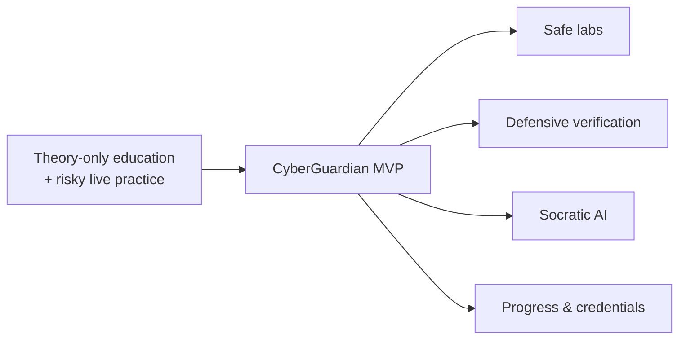
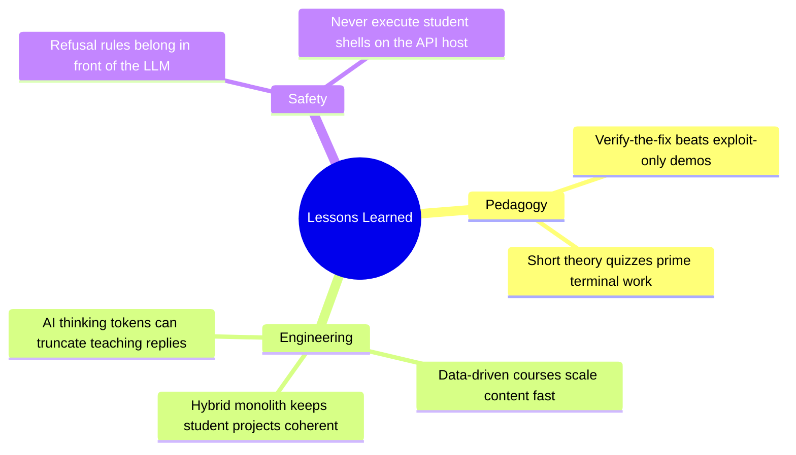
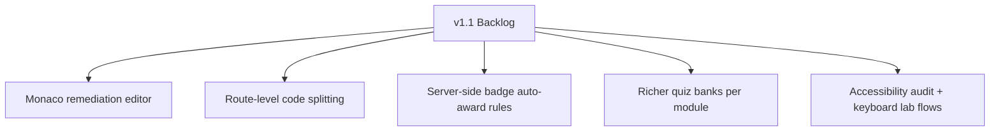
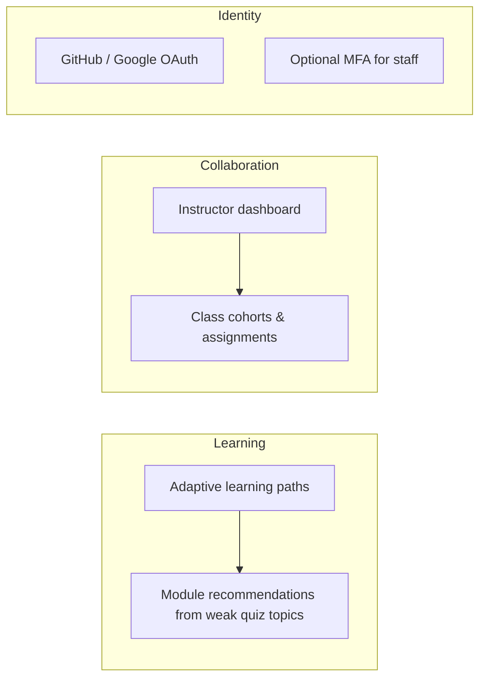
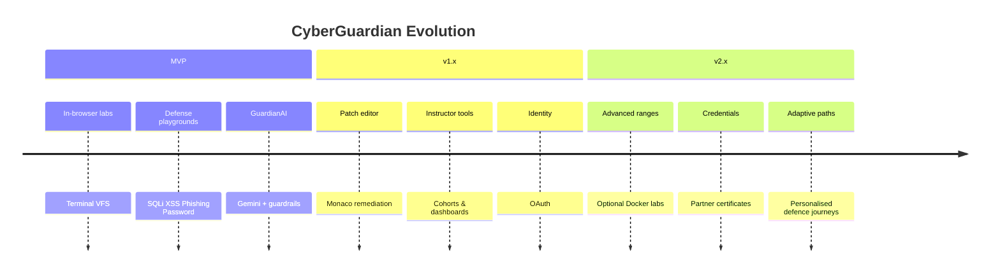
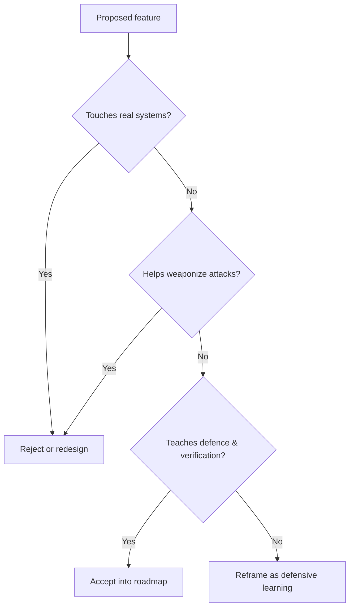

# 5. Conclusion & Future Scope

## 5.1 Conclusion
CyberGuardian was conceived to close the gap between **cybersecurity theory** and **safe hands-on defence practice**. The delivered system demonstrates that a browser-first academy can teach attack mechanics *and* remediation without exposing real systems, without spinning expensive attack ranges, and without abandoning ethical boundaries.

Through five course tracks, dual lab modalities (POSIX VFS terminal and Exploit/Defense playgrounds), theory quizzes, progress persistence, certificates, and a guardrailed AI mentor, the platform realises the original problem statement:

> Learners can observe, practise, verify, and ask for help — all inside an isolated educational environment.

---

## 5.2 Achievements Against Vision

| Vision pillar | Delivered capability |
|---------------|----------------------|
| Zero-risk practice | Client-side sandboxes; no server shell for students |
| Defensive-first pedagogy | Exploit view → Defense view → retest |
| AI mentor | Gemini 2.5 Flash + local ethical fallback |
| Structured learning | Linux, Web/OWASP, Network, SOC, Human Defense |
| Gamified progress | XP, badges, module completion, certificates |

The architecture deliberately chose **Concept A (Interactive In-Browser Cyber Lab)** over container micro-ranges for MVP speed, cost, and safety — a decision validated by the working product.

---

## 5.3 Lessons Learned

Key engineering takeaway: **LLM quality for tutoring is as much about generation settings as prompt text**. Disabling Gemini thinking and enforcing truncation detection turned incomplete mid-sentence answers into usable Socratic guidance.

---

## 5.4 Future Scope

### 5.4.1 Near-term enhancements (v1.1)

| Item | Value |
|------|-------|
| Monaco / CodeMirror patch editor | Let cadets rewrite vulnerable snippets and unit-test the patch |
| Code splitting | Faster first paint on low-end devices |
| Automated badge grants | Tie badge rows to module completion events in the API |
| Expanded quizzes | Multi-question assessments with score history charts |
| A11y | Screen-reader labels for terminal and playground controls |

### 5.4.2 Mid-term roadmap (v1.5)

### 5.4.3 Long-term vision (v2.0+)

| Theme | Description | Caution |
|-------|-------------|---------|
| Dockerized micro-ranges | Ephemeral vulnerable targets for advanced cohorts | Requires isolation, egress control, cost management |
| Blue-team incident arena | Narrative SOC scenarios with branching decisions | Keep simulations event-driven first |
| Team CTF mode | Cooperative defence challenges | Avoid live MITM/PvP networking complexity early |
| Certification partnership | Externally recognised defensive credentials | Needs assessment integrity controls |
| Automated vuln analysis | Static checks on student patches | Stay educational; not a commercial scanner |

---

## 5.5 Research & Academic Extensions
CyberGuardian can support further academic work such as:

1. Measuring learning gain (pre/post quizzes vs traditional lecture)  
2. Studying Socratic AI vs answer-dumping tutors on retention  
3. Evaluating whether Exploit/Defense toggles reduce “flag hunting” without understanding  
4. Accessibility studies for cyber training UIs  

---

## 5.6 Ethical Commitment Going Forward
All future features should preserve the project’s core ethical constraints:

CyberGuardian must remain a **defence education** platform, not an attack toolkit.

---

## 5.7 Final Statement
The CyberGuardian MVP proves that high-impact cybersecurity education can be delivered through carefully designed sandboxes, defensive verification loops, and ethically constrained AI mentoring. The foundation is production-ready for demonstration, classroom pilots, and iterative research. Future versions can deepen realism and institutional features without abandoning the safety-first architecture that made the MVP viable.

---

## 5.8 Document Closure Checklist

| Deliverable | Location |
|-------------|----------|
| Introduction | [01_Introduction.md](./01_Introduction.md) |
| Architecture & HLD | [02_System_Architecture_and_HLD.md](./02_System_Architecture_and_HLD.md) |
| Implementation & Core Logic | [03_Implementation_Details_and_Core_Code_Logic.md](./03_Implementation_Details_and_Core_Code_Logic.md) |
| Results & Testing | [04_Result_Analysis_and_Testing.md](./04_Result_Analysis_and_Testing.md) |
| Conclusion & Future Scope | [05_Conclusion_and_Future_Scope.md](./05_Conclusion_and_Future_Scope.md) |
