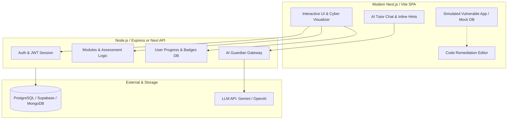

# CyberGuardian: MVP Architecture & Strategy Roadmap

## 1. Executive Summary & Problem Breakdown
**CyberGuardian** is designed to address the divide between theoretical cybersecurity education and hands-on defense. Traditional platforms either lean too theoretical (slides/multiple choice) or require complex, vulnerable virtual machines (like Kali/Metasploitable) that are daunting for beginners and pose infrastructure security risks.

The goal of the MVP is to deliver:
1. **Zero-risk, high-impact practical understanding** of vulnerabilities (e.g., SQLi, XSS, Phishing, Password Attacks).
2. **Defensive-first learning**: Don't just teach how an attack happens—teach how to remediate, sanitize, and verify fixes.
3. **Context-aware AI Cybersecurity Mentor**: An assistant that gives Socratic hints, explains code vulnerabilities, and guards against unethical usage.
4. **Structured gamified progress**: Quizzes, interactive lab challenges, achievement badges, and analytics.

---

## 2. Core Architectural Approaches (3 Distinct Concepts)

| Dimension | Concept A: **"Interactive In-Browser Cyber Lab"** *(Recommended MVP)* | Concept B: **"Dockerized Micro-Range"** | Concept C: **"Gamified Story Incident Arena"** |
| :--- | :--- | :--- | :--- |
| **Core Idea** | In-browser simulated vulnerable applications (mock SQL engine, vulnerable DOM, phishing builder) with real-time defensive code editor. | Backend spawns ephemeral Docker containers per user for Kali Linux / vulnerable web targets. | Scenario/story-driven "SOC Analyst Simulator" where users respond to simulated cyber incidents. |
| **Sandbox Safety** | **100% isolated & safe** by design; runs purely in client-side sandboxes or controlled backend mock endpoints. | High operational risk; requires container isolation, CPU limits, egress blocking, and server scaling. | Safe; logic is event/state driven. |
| **Infrastructure Cost** | **Ultra-low / near-zero**. Free tier friendly (Vercel/Render + Neon/Supabase + LLM API). | **High**. Requires beefy VPS/Kubernetes cluster with container lifecycle management. | Low to moderate. |
| **User Experience** | Instant load times (<1s), zero install, smooth UI animations, visual payload inspectors. | Slower spin-up times (15–45s per container), terminal latency. | Highly engaging narrative, but less open-ended experimentation. |
| **Speed to MVP** | **2–3 weeks** | **6–8 weeks** | **4–5 weeks** |

---

## 3. What We SHOULD Do vs. What We SHOULD NOT Do (MVP Scope Boundaries)

### ✅ What We SHOULD Build (In Scope for MVP)
1. **Interactive Attack & Defense Playground (3–4 Flagship Vulnerabilities)**:
   - **SQL Injection (SQLi)**: Interactive vulnerable login & search queries with a visual query execution visualizer (shows how `' OR '1'='1` breaks query structure), plus a secure code fixer (parameterized query rewrite).
   - **Cross-Site Scripting (XSS)**: Reflected/Stored XSS playground showing simulated cookie/token theft and DOM exploitation, followed by implementing sanitization (`DOMPurify` / escaping).
   - **Phishing & Social Engineering**: Interactive email header and landing page analyzer where users detect red flags (typosquatting, forged headers, deceptive urgency) and write email filtering rules.
   - **Authentication / Password Security**: Hash cracker simulator (MD5 vs bcrypt with salt) and brute force timing simulator to demonstrate salt, pepper, and rate limiting.
2. **Dual-Perspective Learning Interface ("Red vs Blue" Toggle)**:
   - *Exploit View*: See how the attack triggers and what the attacker gets.
   - *Defense View*: Inspect the backend source code, edit the patch, test against the exploit, and verify the fix.
3. **AI Mentor ("GuardianAI") with Ethical Guardrails**:
   - Socratic guidance: Gives step-by-step hints instead of just spitting out exploit payloads.
   - Security Boundary: Rejects requests to generate malicious code targeting real domains or weaponized exploits.
   - "Explain this payload / patch" contextual button inside lab tasks.
4. **Structured Knowledge Modules & Interactive Quizzes**:
   - 4–5 structured modules (SQLi, XSS, Phishing, Ransomware basics, Auth & Cryptography).
   - Bite-sized theory with animated attack-flow diagrams, quiz checks, and immediate feedback.
5. **User Profile, Badges & Skill Matrix**:
   - Auth (Email/Password or GitHub OAuth).
   - Visual progress tracker, defensive mastery score, and challenge completion badges (e.g., "SQLi Shield", "XSS Exorcist").

---

### ❌ What We SHOULD NOT Do in MVP (Avoid Scope Creep)
1. **Do NOT run arbitrary backend bash/terminal code execution**:
   - Running user-provided unchecked shell scripts on your backend creates severe RCE (Remote Code Execution) vulnerabilities on your own server.
2. **Do NOT deploy full Kali Linux GUI / Web-RDP sessions**:
   - Overkill for beginner-intermediate education; requires massive RAM and creates terrible mobile/low-bandwidth experiences.
3. **Do NOT support multi-tenant live attack networks (CTF team PvP)**:
   - Real-time multiplayer packet interception / MITM creates networking complexity best reserved for v2.
4. **Do NOT build a custom LLM from scratch**:
   - Use structured prompt engineering and function calling on modern LLMs (Gemini / Claude / OpenAI) with strict system instructions.
5. **Do NOT attempt to cover all 50+ OWASP / CWE attack types at launch**:
   - Better to have **3–4 polished, deeply interactive modules** than 20 shallow text-only pages.

---

## 4. Proposed High-Level System Architecture

---

## 5. Technology Stack Recommendations

| Layer | Recommended Choice | Rationale |
| :--- | :--- | :--- |
| **Frontend** | **React / Next.js (or Vite + React)** | Fast, modular component hierarchy, vast ecosystem for code editors (Monaco/CodeMirror), and instant visual reactivity. |
| **Backend** | **Node.js (Express or Next.js Route Handlers)** | Fast, lightweight, seamless JSON handling, native async support for AI streaming responses. |
| **Database** | **PostgreSQL (via Prisma or Supabase)** | Relational schema is ideal for users, enrolled courses, module progress, quiz attempts, and badges. |
| **Editor / Lab Tools** | **Monaco Editor** / **CodeMirror 6** | VS Code-grade code editing, syntax highlighting for payloads and backend patches. |
| **AI Integration** | **Gemini Flash / OpenAI API** | Fast token generation, streaming support, cost-effective for conversational tutoring. |
| **Simulation Mechanics** | **Client-side WASM (SQLite / DOM sandboxing)** | Zero server vulnerability, zero hosting cost, instantaneous execution feedback. |

---

## 6. Phased MVP Implementation Plan

### Phase 1: Core Foundation & Dashboard (Days 1–5)
- User authentication (JWT / session).
- High-tech, dark-mode cybersecurity UI (cyber radar chart, module progression tracker).
- Database schemas for users, modules, progress, quiz submissions.

### Phase 2: Interactive Attack & Defense Labs (Days 6–12)
- **Lab 1: SQL Injection (SQLi)**: Live query visualizer + input injection + code patch editor (parameterized query).
- **Lab 2: Cross-Site Scripting (XSS)**: DOM & Reflected payload execution in an isolated iframe/mock DOM + sanitization fix.
- **Lab 3: Phishing Email & Domain Analyzer**: Interactive header inspector + domain similarity checker (punycode/typosquatting).
- **Lab 4: Password Hashing & Brute Force**: Visual bcrypt vs MD5 hash cracker simulation.

### Phase 3: AI Guardian Mentor & Assessment Engine (Days 13–18)
- Real-time conversational AI tutor with ethical guardrails and Socratic hints.
- Quiz engine with instant explanations and score recording.
- Badge & achievement system with certificate of completion.

### Phase 4: Polish, Testing & Deployment (Days 19–21)
- End-to-end user testing.
- AI prompt injection hardening.
- Production deployment setup.
